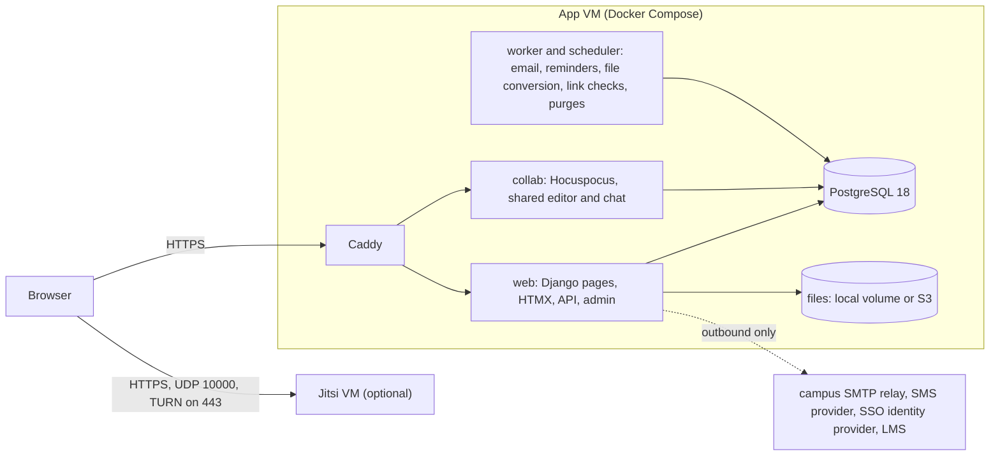
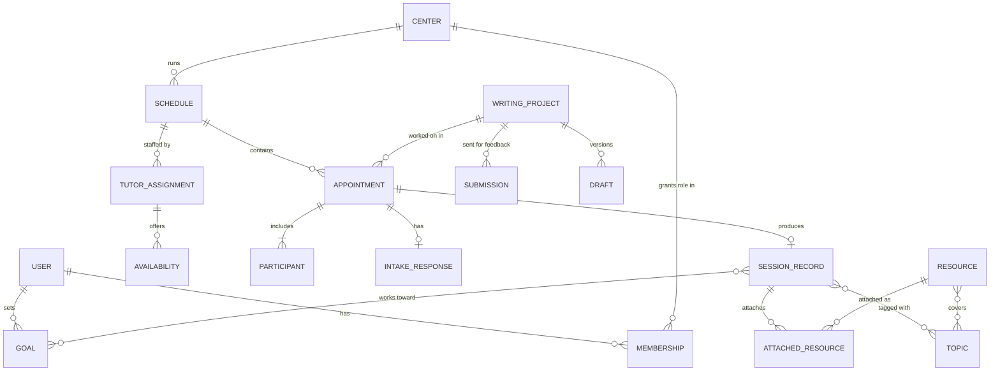

# Sympraxi build plan

Sympraxi is an open-source scheduling, session-records and training system for college writing centers. It replaces WCONLINE and goes further in three areas: a writing history that students can see, a shared topic vocabulary across all records, and a writing-resource library tutors can attach to sessions.

Read this together with [01-feature-map.md](01-feature-map.md) (what WCONLINE does and what we do about each feature) and [03-resource-library.md](03-resource-library.md) (licensing rules for Purdue OWL and open resources).

Research for this plan was done on October 14, 2026. Version numbers, legal deadlines and licenses below were current on that date; recheck them before relying on any of them.

## 1. Goals and ground rules

1. **A center can run a full term on it.** Booking, notes, reminders, no-shows, hours and reports all work on day one, not a demo.
2. **Student records are protected.** Session notes are FERPA education records (§6). Access is scoped by role and center, every read of a note is logged, and nothing is sent outside the college unless it has to be.
3. **Stable enough for a two-person IT shop.** Long-term-support dependencies, few moving parts, one-command backup and restore, and no upgrades forced mid-term.
4. **Accessible to everyone, in one interface.** WCAG 2.2 AA, with no separate "text-only" version.
5. **Students and centers can see change over time.** Sessions connect to writing projects, goals and topics, so a student's history and a center's trends come out of the records already kept.
6. **No barriers.** No license fee, no vendor accounts required, full data export at any time, and documentation good enough for a center without a developer.

### Not in the first release

- Payments, test proctoring, and room or equipment booking unrelated to tutoring.
- Session recording. It raises consent and FERPA problems, and several states require every party's consent to record. It stays off unless a later release adds it behind explicit consent.
- Native mobile apps. The web app is responsive and works on phones.
- AI features. If they come later, they have to be opt-in, run on infrastructure the college controls or under a FERPA-compliant contract, and never train on student writing.

## 2. Prior art: build, don't fork

No maintained open-source writing-center or tutoring-center system exists. A GitHub search for "writing center" finds class projects, center websites and data scripts. The general booking tools don't model students, notes or tutor training:

| Project | License | Use to us |
|---|---|---|
| Moodle Scheduler (mod_scheduler) | GPL (Moodle plugin) | Closest match: teachers post slots, students book, teachers record outcomes. Study its data model |
| Easy!Appointments | GPL-3.0, PHP | Booking flow ideas |
| LibreBooking | GPL-3.0, PHP | Quota, credit and waitlist rules |
| django-appointment | Apache-2.0, Django | Reminder and booking patterns if we use Django |
| Thunderbird Appointment | MPL-2.0, Python | Calendar sync and a clean Docker Compose layout |
| Cal.com / Cal.diy | MIT (since April 2026) | **Not a base.** Cal.com took its production code private in April 2026. The public Cal.diy repo lost teams, SAML and the API, and its README advises against production use |

The Cal.com change is also a licensing lesson; see §11.

## 3. Recommended stack

| Layer | Choice | Why |
|---|---|---|
| Backend | **Django** (6.1 now, moving to 6.2 LTS when it ships in April 2027, before the pilot; see [decisions.md](decisions.md)) | Built-in admin, permissions, ORM and migrations; the longest predictable support window of the frameworks compared; Python is the language higher-ed IT staff and student developers most often know |
| Database | **PostgreSQL 18** | Range types and exclusion constraints make double-booking impossible at the database level (§5.3) |
| Accounts and login | **django-allauth** | One maintained package covers local accounts, email verification, rate limiting, TOTP, recovery codes, passkeys, OIDC and SAML |
| Pages | Server-rendered Django templates with **HTMX**, plus small JavaScript "islands" for the booking calendar and the shared editor | Less JavaScript means a smaller attack surface, fewer accessibility traps, and a codebase a Python developer can maintain |
| Design system | **U.S. Web Design System** 3.14 (public domain code; open-licensed fonts and icons), without the government banner | Tested accessible components instead of hand-built ones |
| Background jobs | Django's built-in Tasks framework with the `django-tasks-db` backend: jobs live in Postgres, so small installs need no Redis or Valkey | Reminders, emails, file conversion, link checks and retention purges |
| Live collaboration | **Tiptap + Yjs + Hocuspocus** (all MIT), as a small Node sidecar that checks Django-issued tokens and stores documents in Postgres | A shared editor that keeps headings, lists and tables. Session chat lives in the same Yjs document, so no separate chat server is needed |
| Video | **Jitsi Meet** (Apache-2.0) self-hosted with docker-jitsi-meet on its own VM; the app issues a token per participant | Full UI included, iframe API, TURN on port 443 for locked-down networks. **Fallback from day one:** a meeting-link field for the campus Zoom, Teams or Meet. Optional later adapter for campuses that already run BigBlueButton |
| Documents | mammoth.js (BSD-2) to turn .docx into HTML for the shared editor, sanitized and run in a worker; PDF.js (Apache-2.0) for viewing PDFs, with comments stored as app data | In-browser feedback instead of a Word file round-trip |
| File storage | Local volume by default; any S3-compatible service optional (campus S3, AWS, SeaweedFS, Garage) | Don't ship MinIO: its community repository is archived |
| Cache | Valkey (BSD-3), optional | Only needed at larger scale. Redis 8 changed to RSAL/SSPL/AGPL licensing |
| Reverse proxy | **Caddy** | Automatic TLS certificates |

**Why not the alternatives.** Rails 8 is a close second. Solid Queue and Solid Cable remove Redis entirely, but fewer campus developers know Ruby. Laravel's SSO and passkey story runs through a hosted vendor. A Next.js stack means assembling auth, ORM and admin from parts, and in December 2025 a CVSS 10 remote-code-execution bug hit React Server Components. That kind of emergency patch is hard on a two-person shop.

## 4. Architecture



Valkey (cache) and ClamAV (upload scanning) are optional containers on the same VM.

A minimal production install is one app VM (2 to 4 vCPU and 4 to 8 GB RAM is an estimate to confirm in load testing) and, for built-in video, one Jitsi VM (4 cores and 8 GB). A center that uses its campus Zoom or Teams instead can skip the Jitsi VM entirely.

### Repository layout

```
/
├── sympraxi/               Django project (settings, URLs, WSGI/ASGI at the top level)
│   ├── core/               permission policy, shared views, email queue, template tags
│   ├── accounts/           users, roles, memberships, MFA, SSO
│   ├── centers/            centers, terms, branding, settings
│   ├── scheduling/         schedules, availability, appointments, limits, waitlist
│   ├── forms/              form builder: registration, intake, session report, survey, observation
│   ├── records/            session records, writing projects, goals, topics, student timeline
│   ├── resources/          resource catalog and attachments
│   ├── feedback/           asynchronous submission queue and comments
│   ├── online/             video rooms, collaboration tokens
│   ├── staff/              time clock, kiosk, training
│   ├── notify/             email, SMS plug-ins, calendar feeds, consent records
│   ├── reports/            statistics, exports, research export
│   ├── privacy/            audit log, disclosure log, retention, legal hold, record export
│   └── integrations/       API, webhooks, LTI 1.3, importers
├── collab/                 Hocuspocus sidecar (Node, small)
├── frontend/               booking calendar and editor islands (Vite build)
├── catalog/                resource catalog and topic vocabulary as YAML (separately licensed, §11)
├── deploy/                 Docker Compose, Caddyfile, Jitsi guide, backup/restore scripts
└── docs/
```

## 5. Data model

### 5.1 Core entities



| Entity | Holds |
|---|---|
| User | Identity: name, email, optional student ID, linked SSO subjects, pronouns (optional), status |
| Membership | User + center + role (student, tutor, front desk, director). One person can be a student in one center and a tutor in another |
| Schedule | Term dates, hours, increments, buffers, visibility, booking-limit policy |
| Tutor assignment | A tutor on a schedule, with length limits, caps, modalities, focuses and group capacity. One account, many assignments |
| Availability | A weekly template in the center's time zone, plus exceptions (blackouts and extra hours) |
| Appointment | Tutor, time range, modality (in person, online, asynchronous), status, flags (walk-in, placeholder, tentative), series ID, meeting link |
| Form, form version, question | Forms are versioned. Questions have permanent IDs, so reordering or rewording never scrambles past answers |
| Intake response | The answers a student gave when booking, tied to the form version they saw |
| Session record | Staff notes, a student-facing summary, next steps, topics, stage, tutor actions, attached resources, actual length, and status (draft or final). After it is finalized, edits are kept as amendments |
| Writing project | One piece of writing across sessions: title, course, instructor, genre, due date, drafts |
| Goal | Something a student is working on across projects ("integrate sources instead of dropping quotes"), with a status the student and tutor update |
| Topic | One term in the controlled vocabulary (§8.3) |
| Resource, attached resource | A catalog entry, and its attachment to a session with an optional note from the tutor |
| Submission | An asynchronous feedback request: files, the kind of feedback wanted, due date, queue status, comments |
| Time entry | Clock in/out, category (tutoring, training, admin), linked appointment, edits with reasons |
| Training module, completion, observation | Tutor training content and progress |
| Consent record | SMS opt-in, instructor-sharing consent, any recording consent: who, what, when, and how it was withdrawn |
| Audit log, disclosure log | Who read or changed which record; what was sent to whom outside the center (FERPA 99.32) |

### 5.2 How "change over time" works

WCONLINE stores a report per appointment and leaves the rest to spreadsheets. Here the record structure does the tracking:

- **Before a session**, the tutor sees a one-screen brief: the student's open goals, the current writing project and its last draft, the next steps from the last three sessions, and which resources were attached before.
- **During the report**, the tutor tags topics on three separate axes (concern, writing stage, tutor action), writes a summary addressed to the student, sets next steps, and attaches resources. Topic tags suggest resources.
- **After the session**, the student's "My writing" page shows every session's summary, next steps and resources, grouped by project, with their goals across the top.
- **Across a center**, directors see topic trends by term, course, modality and student population; resource use; and how goals change across repeat visits. A de-identified research export supports IRB-approved writing-center research.

### 5.3 Correctness rules enforced by the database

- **No double booking.** A Postgres exclusion constraint on `(tutor, tstzrange(start, end))` for active appointments makes overlapping bookings impossible even if two students click at the same instant. Group slots lock the appointment row and check capacity in one transaction.
- **Time zones.** All times stored in UTC. Weekly availability is stored in the center's local time and expanded with `zoneinfo`, with tests for both daylight-saving transitions.
- **Form history.** Answers reference question IDs and form versions, never positions.
- **Finalized records.** A finalized session record can't be silently overwritten. Every change after finalizing is an amendment with author, time and reason.

## 6. Security and privacy

### 6.1 FERPA design rules

Session notes kept in this system are education records under 34 CFR 99.3. They relate directly to a student and are kept by the institution. The "sole possession" exception covers only private memory aids nobody else sees, so it doesn't apply to shared notes. WCONLINE's terms of service don't mention FERPA at all. The system builds in the following:

1. **Students can see their records.** Students have a right to inspect their education records within 45 days of a request, and that includes staff notes. By default, students see the summary, next steps and resources from each session; a center can choose to show staff notes as well. A director can produce a complete export of one student's record in a single step to answer a formal request. The note-writing screen tells tutors that students can request everything they write.
2. **Access is limited to legitimate educational interest.** Roles are scoped to a center. By default, tutors see the history of students on their own schedule. Directors can widen or narrow that per center.
3. **Every read of a session record is logged** with who, when and from where. WCONLINE logs sends but not reads.
4. **Disclosures are logged** (99.32): every instructor email, early alert and export that leaves the center, kept as long as the record.
5. **Students choose what instructors get.** A student decides per session whether a visit confirmation goes to the instructor. The default email carries attendance only, not the notes.
6. **Emails carry as little as possible.** Notification emails say a summary is ready and link to it. Centers can choose to include the summary text.
7. **Students never see other students.** Calendars show taken slots without names. Workshop rosters are visible only to staff. A FERPA directory-information block from the student information system hides a student's name everywhere a non-staff user could see it.
8. **Retention.** Each center sets a retention period. A scheduled purge removes expired content and keeps de-identified counts. A legal hold stops the purge, and so does a pending inspection request (99.10). Backup retention matches the purge period.
9. **Hosting.** Sympraxi is built for self-hosting first. When a college self-hosts, the project's maintainers never receive student data. If a consortium or company later offers hosting, it needs a contract that places it under the college's direct control (99.31(a)(1)(i)(B)) and limits redisclosure (99.33). The same applies to any SMS, email or video provider a center connects. The deployment guide includes a checklist for this.

### 6.2 Threats and controls

| Threat | Controls |
|---|---|
| A user reaches another student's or another center's records by editing an ID in a URL (IDOR) | One policy module decides every permission (`can(user, action, object)`), and querysets are scoped by center by default. A test matrix exercises every view against every role. Public IDs are UUIDs |
| Staff account takeover | Multi-factor login required for tutors, front desk and directors (authenticator app or passkey, not text codes). Rate limiting, login-alert emails, configurable session timeouts |
| Malicious uploads | Type checks on actual file content, size limits, optional ClamAV scan, conversion in a worker, files served as downloads through short-lived signed URLs with a sandboxing Content Security Policy, never rendered inline as HTML |
| Script injection through notes or the shared editor | Django autoescaping, server-side HTML sanitizing with nh3, a strict nonce-based Content Security Policy |
| Uninvited people in a video room | A token per participant, valid only within the appointment's join window, and a lobby the tutor controls |
| Vulnerable dependencies | Locked dependency hashes, Renovate updates, pip-audit, npm audit, Semgrep or CodeQL, Trivy image scans, an SBOM and signed container images for each release. SAML libraries have a history of signature-bypass bugs, so they are pinned and patched quickly |
| Data loss | Nightly `pg_dump` plus restic encrypted off-site copies; `backup` and `restore` commands; a restore drill every term |
| Insider misuse | Read audit log, director-visible access reports, and an append-only log table |

### 6.3 Project security practices

- `SECURITY.md` with a private reporting address and response times.
- A written threat model, updated each phase.
- An external security review before 1.0.
- **A pre-filled HECVAT** (the higher-ed security questionnaire) and an **Accessibility Conformance Report (VPAT)** published with each release. Campus IT and procurement ask for both before approving any system that holds student data, so having them ready removes the biggest adoption barrier.

## 7. Accessibility

The DOJ's ADA Title II rule requires WCAG 2.1 AA for public colleges' web content, including content provided through contracts or licenses. An interim final rule of April 20, 2026 moved the deadlines to **April 26, 2027** for public entities serving 50,000 or more people and **April 26, 2028** for smaller ones. The National Federation of the Blind sued over the delay in May 2026. Check the current status (RIN 1190-AA82) before quoting these dates.

The project targets **WCAG 2.2 AA**, which includes 2.1:

- **Booking is a list first.** Pick a date, see open times as a list, choose one. The week grid is a second view, and color is never the only signal. That reverses WCONLINE's arrangement, where the grid is the main view and the accessible path is a separate page.
- **Nothing depends on dragging** (2.5.7). Every drag action has a button alternative.
- **Targets are large enough** (2.5.8), and sticky calendar headers never cover the focused element (2.4.11).
- **Login is accessible** (3.3.8). Paste and password managers work, and passkeys are offered.
- **Testing.** axe-core checks run in CI on every page. Each phase gets manual testing with NVDA and VoiceOver and keyboard-only passes. An updated Accessibility Conformance Report ships with each release.
- **Video.** Live captions in Jitsi are worth evaluating in Phase 2. Until then, the shared chat and editor give a text channel in every online session.

## 8. Writing resource library

Full details, including the license table, are in [03-resource-library.md](03-resource-library.md). The rules that shape the build:

### 8.1 Link, don't copy

- **Purdue OWL** allows deep links without permission. It forbids copying its text, presenting pages in frames, and commercial use. The catalog stores a URL, the title, and a summary written by our own contributors, never OWL text. Purdue's sitemap (about 1,240 URLs with last-modified dates) is a good source for finding pages and noticing changes.
- **No iframes.** Purdue, MLA and APA forbid framing, and many writing-center sites send headers that block it anyway.
- **Openly licensed material** comes in two kinds:
  - CC BY sources (for example *About Writing: A Guide*, and the OpenStax *Writing Guide with Handbook* from before its 2026 switch to NonCommercial) can be copied and adapted with attribution.
  - Most other open writing material is NonCommercial, NoDerivatives or ShareAlike. It goes in an optional content pack that keeps its own licenses, separate from the code.

### 8.2 How it works in a session

1. The tutor tags the session's topics in the report.
2. The resource panel suggests catalog entries for those topics, plus the center's own handouts and the tutor's favorites. A search box covers the whole catalog.
3. One click attaches a resource, with an optional note ("Read the section on signal phrases before Thursday").
4. The student sees the resources in the session summary and on their "My writing" page.
5. A weekly link checker, which obeys robots.txt and crawl delays, flags broken or moved links for a director to fix.

The catalog lives in the repository as YAML, so the community can add and correct entries through pull requests. Centers add local handouts and links through the admin screens.

### 8.3 Topic vocabulary

No standard writing-center topic list exists. The project publishes its own under CC0, on three axes, so a single catch-all like "revising" can't swallow everything:

- **Concern:** thesis, organization, evidence, citation:apa, citation:mla, grammar:articles, genre:literature-review, and so on.
- **Stage:** understanding the assignment, brainstorming, drafting, revising, editing.
- **Tutor action:** asked questions, modeled, explained, read aloud, made a plan, and so on.

The first version should be checked against the session-note question bank in the IWCA-funded Writing Center Session Note Data Repository (Modey, Cheatle and Giaimo, University of Michigan Deep Blue Data, CC BY-NC 4.0) and cite it. Centers can add local terms, but they can't rename shared ones, so data stays comparable across centers.

## 9. Phases

Sizes assume one developer working close to full time with AI coding help. A part-time or student team should roughly double them. Each phase ends with exit criteria that have to be met before the next one starts.

### Phase 0: Foundation (3 to 4 weeks)

- Repository, license, `CONTRIBUTING`, `SECURITY.md`, code of conduct, DCO sign-off.
- Django project, Postgres, job worker decision, Docker Compose for development and production, Caddy.
- Local accounts with email verification, required multi-factor login for staff, passkeys.
- Centers, memberships and roles, plus the single policy module and its test matrix.
- Audit log.
- Design-system choice, base layout, axe-core in CI.
- CI: tests, linting, type checks, dependency and image scanning.
- `backup` and `restore` commands.

**Exit:** a fresh install from the docs takes under 30 minutes; a backup restores cleanly onto a new machine; every page passes axe.

### Phase 1: Core release, enough to run a term (8 to 10 weeks)

- **Single sign-on through OIDC for Microsoft Entra ID and Google Workspace,** early in the phase, alongside local accounts. Each center enters its own tenant's settings. Pilot campuses are expected to require this from day one.
- **A draft HECVAT Lite and accessibility notes** for the pilot campus's IT review. Campuses usually want both before student data goes in.
- Terms, schedules, rooms, tutor assignments, availability templates and exceptions, buffers.
- Booking engine: limits, notice, horizon, change cutoff, exemptions with expiry dates, limits across schedules, the double-booking constraint, time-zone handling.
- List-first booking interface, week grid, keyboard support.
- Appointment types: in person; online through a meeting link; walk-in; placeholder; tentative; basic group; repeating series where every appointment keeps its own files and notes.
- Form builder for registration, intake, session reports and surveys, with versions, permanent question IDs and simple conditions.
- Session records: staff notes, student summary, next steps, topic tags, finalize-and-amend, off-schedule records, group copies, missing-report reminders.
- **Resource attachment from a starter catalog** (Purdue OWL plus CC BY material) and a first topic vocabulary. This is the quick win and needs nothing from later phases.
- Writing projects (basic) and the student's "My writing" page.
- Cancellations, late cancellations, auto-flagged possible no-shows for staff to confirm, blocks that expire and are logged.
- Email confirmations, reminders, .ics files, private calendar feeds, announcements, mass email.
- Basic time clock with categories.
- Statistics, utilization, master lists, CSV/XLSX/JSON export, full-center export.
- CSV user import.
- FERPA basics: read log, disclosure log, student record export.

**Exit:** a pilot center can run a low-volume term on it (summer is ideal). A load test that simulates the first-Monday rush (for example, 500 students booking within ten minutes) produces no double bookings and acceptable response times. A WCAG 2.2 AA review of every student-facing flow passes.

### Phase 2: Online and asynchronous sessions (6 to 8 weeks)

- Jitsi deployment guide and integration: a room per appointment, tokens per participant, join windows, lobby.
- Session room page: video, shared editor (Tiptap, Yjs, Hocuspocus), chat in the same document, .docx import, PDF viewing, document version history.
- Asynchronous queue: request form, claiming or automatic assignment by focus and load, comments on PDFs and converted .docx files, return of feedback, due dates, overdue alerts, turnaround statistics. Uploading a commented Word file still works.
- Upload hardening: optional ClamAV, signed URLs, worker-side conversion.
- Bulk modality change (snow days) with automatic notices to students.

**Exit:** an online session works from a locked-down campus network (TURN over 443); asynchronous turnaround shows in reports; a center that skips Jitsi still has everything else working through meeting links.

### Phase 3: Resource library and long-term tracking (4 to 6 weeks)

- Full catalog: YAML entries with licenses, community summaries, the link checker, center handouts, tutor favorites, suggestions by topic.
- Optional open-content pack with per-item attribution.
- Goals, the tutor's pre-session brief, the full student timeline across terms.
- Topic and resource dashboards for directors.
- De-identified research export, with the IRB protocol number recorded.
- **WCONLINE importer** that reads its Excel exports (appointments, reports, registrations, time clock) so a center keeps its history. This needs sample exports from a real center to build against.

**Exit:** a director can answer "what did first-year students come in for this term, by course?" and "what has this student worked on across three terms?" without a spreadsheet.

### Phase 4: Staff operations and training (4 to 6 weeks)

- Full time clock: network restriction, edits with reasons, approvals, timesheet export for payroll.
- Kiosk check-in, card-swipe support, waiting room.
- Waiting list that offers an open slot to one student at a time with a hold, then moves to the next.
- Workshops with rosters and attendance.
- Tutor training: modules (pages, readings, video links), short quizzes, required hours, observation forms built with the form builder, mentor sign-off, completion tracking.

**Exit:** a new tutor cohort can complete onboarding inside the system, and payroll can use its timesheets.

### Phase 5: Campus integration and 1.0 (6 to 8 weeks)

- More single sign-on: SAML (Shibboleth and other SAML providers), CAS, and other OIDC providers such as Okta. Student-ID mapping and account linking.
- LTI 1.3 launch from Canvas first, then Moodle and D2L, to prefill course and instructor fields. LTI is a launch path, not the only way to log in.
- Read/write API with scoped tokens, and webhooks.
- SMS as an optional plug-in provider, with an opt-in that isn't pre-checked, stored consent, and STOP/HELP handling. Email-to-SMS gateways are not used (AT&T closed its gateway in 2025 and Verizon is closing its own).
- Early alerts that require a recorded reason; an optional faculty view of visit confirmations the student chose to share.
- Multi-center polish; a first translation (Spanish).
- External security review, HECVAT, Accessibility Conformance Report, 1.0 release.

**Exit:** a second campus installs and runs it without help from the core team.

### Rough calendar

| When | What |
|---|---|
| Nov 2026 | Phase 0 |
| Nov 2026 to Mar 2027 | Recruit a pilot center. Its IT office registers the app with Entra ID or Google and reviews the draft HECVAT |
| Dec 2026 to Mar 2027 | Phase 1 |
| Apr to May 2027 | Phase 2 |
| Summer 2027 | Pilot term at one center; Phase 3 |
| Aug to Sep 2027 | Phase 4 |
| Oct to Dec 2027 | Phase 5; 1.0 ready for spring 2028 adoption |

The calendar runs longer than the phase sizes add up to (31 to 42 weeks) because it leaves room for holidays and the pilot. Its real use is to land the pilot in a quiet summer term and keep releases away from the first weeks of fall and spring.

**Pace check.** Sympraxi is built by one person with Claude Code. Phases 0 and 1 come to 11 to 14 full-time weeks. Finishing them by mid-May 2027 for a summer pilot works out to roughly half-time from November. If that isn't realistic, the summer pilot can run Phase 1 alone with meeting links for online sessions, and Phase 2 can follow in the fall.

**Pilot recruitment is on the critical path.** No pilot center is lined up yet. Campus IT approval (SSO registration, a security questionnaire, sometimes an accessibility review) can take a couple of months, so a center should be found by March 2027 at the latest.

## 10. Keeping it stable

- **Releases follow the academic calendar.** Feature releases in late May and late December. Security patches any time. Upgrade notes flag schema changes, and the docs advise against schema-changing upgrades mid-term. A long-term-support release each year gets security fixes for two years.
- **Tests at every level.**
  - Property-based tests (Hypothesis) for the booking engine: no sequence of bookings, cancellations and edits can break a limit or double-book a tutor.
  - The permission matrix: every view against every role.
  - Playwright end-to-end tests for the main flows, with axe checks.
  - Migration tests against an anonymized fixture database.
  - A load test for the first-week rush before each feature release.
- **Running it.** Health-check endpoint, structured logs with student data scrubbed, optional error tracking with a self-hosted Sentry-compatible tool, and a status page in the admin screens for queue backlog, failed emails and link-check results.
- **Few services.** Postgres, the web app, a worker, the collaboration sidecar and Caddy. Valkey, ClamAV and Jitsi are optional.

## 11. Licensing and governance

- **Code: AGPL-3.0-or-later** (decided; campus counsel review still to come). Anyone who runs a modified version must offer its source to their users, which a "source" link in the footer covers. This stops a company from selling a closed hosted fork. GPL doesn't cover hosted use, and MIT or Apache would allow closed forks. Canvas LMS and Open edX are AGPL precedents to cite if campus counsel is wary.
- **Contributions: DCO sign-off, not a copyright assignment.** Cal.com could relicense in April 2026 because one company owned the copyright. Spreading ownership across contributors makes that much harder.
- **Topic vocabulary and catalog metadata: CC0**, so anyone can reuse them.
- **Vendored open content: its original licenses**, in a separate optional content pack.
- **Clean-room build.** Use WCONLINE's public feature descriptions as a checklist, but don't copy its code, help text, screens or branding, and don't use its name in the product name. Describing the project as "an open-source alternative to WCONLINE" is ordinary comparative use; have counsel confirm before launch.
- **Community.** Open the repository early. Invite writing-center directors through IWCA and regional associations to review the feature map and the topic vocabulary. Long term, look for a home with a consortium or a fiscal sponsor, so the project doesn't depend on one person.

## 12. Risks

| Risk | Mitigation |
|---|---|
| One maintainer is a single point of failure (Sympraxi starts with one developer) | Code and docs written so someone else could pick them up; a small codebase; DCO; early outreach to other centers; a second maintainer recruited before 1.0; a consortium home later |
| A breach of student records | §6 controls, an external review before 1.0, self-hosting by default, data minimization |
| Video is too much for campus IT to run | Meeting-link fallback from day one; Jitsi stays optional |
| Chasing full WCONLINE parity delays a usable release | Phase 1 covers what a center needs for a term; the rest waits for pilot feedback |
| Accessibility regressions | axe in CI, manual screen-reader passes each phase, a published conformance report |
| Purdue OWL changes its terms or URLs | Link-only catalog, weekly link checks, no copied content |
| NonCommercial content misused by a paid host | The content pack is separate and optional, with its licenses stated |
| Campus counsel resists AGPL | Point to Canvas and Open edX; colleges that run it unmodified owe nothing extra |

## 13. Decisions

### Settled on October 14, 2026

| Question | Decision | Where it shows up |
|---|---|---|
| Project name | **Sympraxi.** A web and GitHub search found no software by that name. The nearest are Sympraxis Consulting (a Microsoft 365 consultancy, different spelling) and three empty GitHub repositories named "Sympraxis" | Throughout |
| Pilot term | **Summer 2027** | §9 calendar |
| Pilot center | **None lined up yet**; recruit one by March 2027 | §9 calendar |
| Who builds it | **Justin, working with Claude Code** | §9 pace check, §12 |
| Single sign-on at pilot | **Yes, Microsoft Entra ID or Google** (OIDC), moved into Phase 1. SAML and CAS stay in Phase 5 | §9 Phases 1 and 5 |
| License | **AGPL-3.0-or-later** | §11 |
| Hosting | **Self-hosting first.** Consortium hosting may come later, only under FERPA contracts | §6.1 item 9 |
| What students see | **Summary, next steps and resources by default; each center can also show staff notes** | §6.1 item 1 |

### Still open

1. **Find a pilot center** by March 2027.
2. **Have campus counsel look at AGPL** before the repository goes public.
3. **Secure the name:** run a USPTO trademark search, register a domain (sympraxi.org, .com, .dev and .io had no DNS records on October 14, 2026, which suggests but doesn't prove they're available), and create the GitHub organization.
4. **Outreach.** Purdue OWL got the courtesy note its policy asks for, through its contact form on October 15, 2026; it says to allow one to two weeks for a reply. Excelsior confirmed on October 16 that its OWL is CC BY-NC 4.0 and corrected its footer, so that question is closed.
